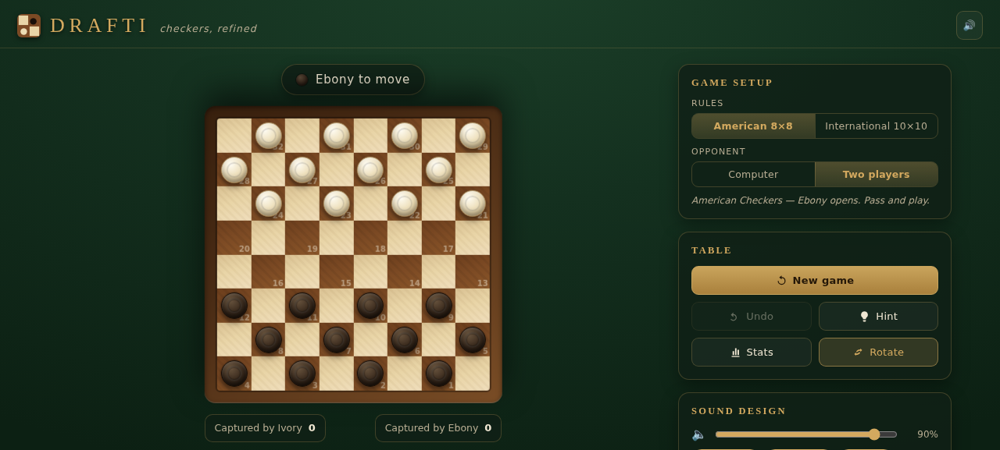
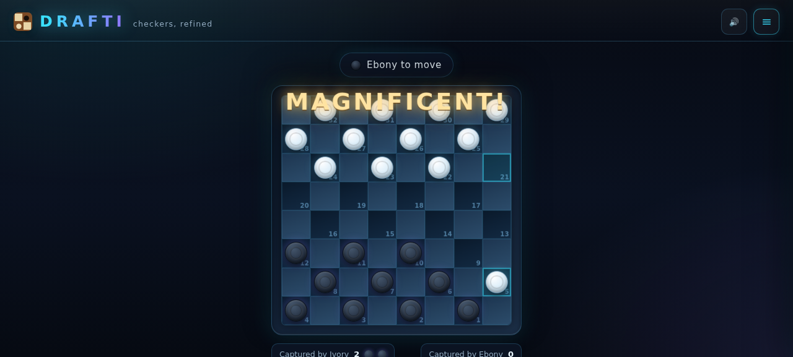
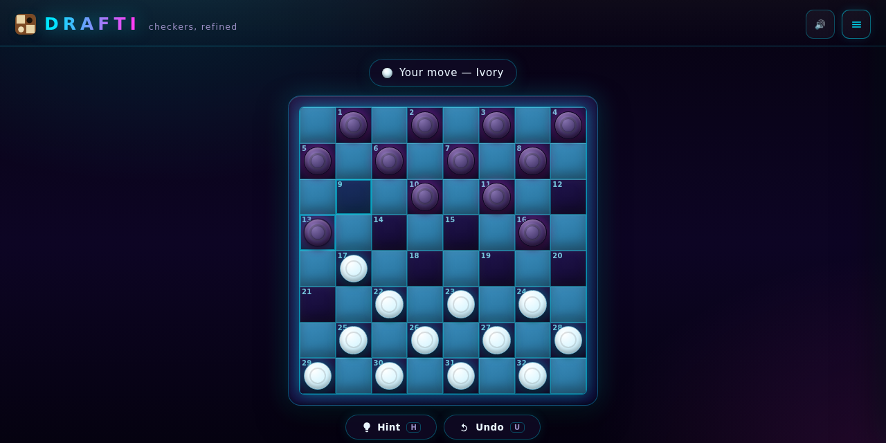
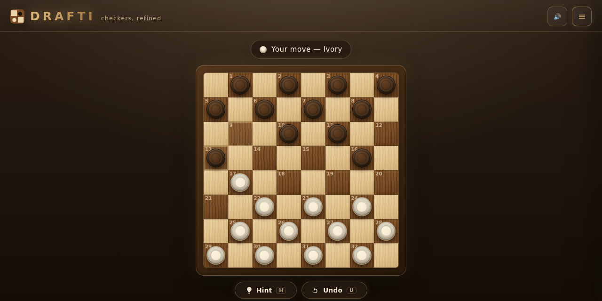
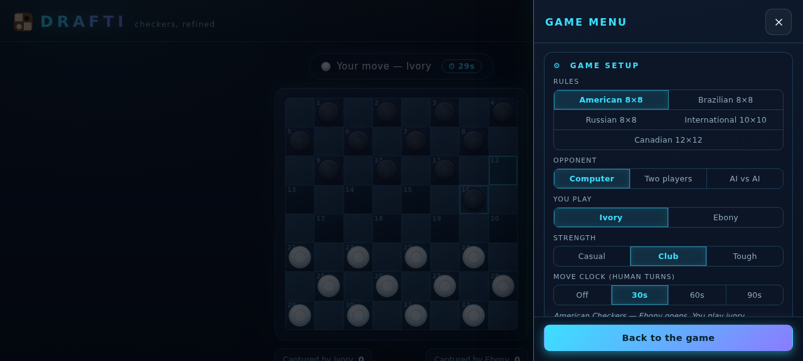

# DRAFTI — checkers, refined

An **original, open-source checkers game**. DRAFTI is an independent
implementation of the public-domain game of draughts — no code, assets, or
data were taken from any commercial app. The rules of checkers belong to
everyone; DRAFTI is our own take on them.



A double jump lands the **"Double!"** callout, the *"You are a bad boy!"*
shaming, a heavy-hit voice and a board jolt — with your name in the banner:



## Features

- **Five international rulesets**
  - *American Checkers* (English draughts, 8×8) — dark side opens, men capture
    forward only, kings step one square, crowning a man ends the move.
  - *Brazilian Draughts* (8×8) — international rules on the smaller board.
  - *Russian Draughts* (Shashki, 8×8) — captures are mandatory but there is no
    majority rule, and a man crowned mid-capture **continues the same move as
    a flying king**.
  - *International Draughts* (FMJD, 10×10) — light side opens, men capture
    forwards *and* backwards, flying kings land anywhere behind the jumped
    piece, and the **maximum-capture rule** is enforced.
  - *Canadian Draughts* (12×12) — international rules on the grand board,
    30 men a side; flying kings own the long diagonals.
- **Three game modes**
  - *Computer* — negamax with alpha-beta pruning, iterative deepening and a
    transposition table, running in a Web Worker so the board never freezes.
    **Ten levels on one ladder**: Beginner, Novice, Casual, Club, Expert,
    Master, Grandmaster, Super GM, World Champion and The Machine — the weak
    rungs blunder and wander like a human novice, the top rungs think for
    seconds a move and never blink. Your highest conquered level is tracked
    in the record, with a fanfare the first time you take a new rung.
  - *Two players* — pass-and-play on one device, with optional automatic
    board rotation each turn.
  - *AI vs AI* — spectate two engines playing each other, with pause and
    1× / 2× / 4× speed. With **auto-rematch** on, the show never stops — and
    it is never a nameless "AI vs AI": a **world arena of 194 national
    teams** plays a title challenge. **Tanzania hosts the board** and Kenya
    comes calling first (the neighbourly rivalry), then East Africa, the
    rest of Africa, and every nation across Europe, Asia, the Americas and
    Oceania. **The winner keeps the board** and faces the next name; a
    beaten champion joins the back of the line, so no nation hogs the
    schedule; each challenger gets a set number of rounds (1 by default,
    editable) before the next nation shifts in. Every **12 bouts closes a
    season** and the next one opens with the whole world one rung stronger;
    a full pass of the ladder reshuffles the queue. Every game teaches:
    wins add experience, defeats add more, experience climbs the ladder —
    and a challenger never faces a champion more than two rungs above it,
    so bouts stay fair. When the whole world has appeared and the champion
    is still standing, it **retires with a full ceremony**: the winner's
    name takes the centre of the board while the crowd asks *"How can you
    allow the one with that skill to retire?!"* — and you can retire any
    champion yourself with the 🎖 Retire button. Every nation's name is
    renameable in The players (the grid lists the teams in play, with an
    all-nations expander). Prefer the old way? Turn the arena off and
    hand-pick the two national schools.
  - **AI human playing mode** (in the arena card) — the engines stop moving
    like metronomes and start moving like people at a table: quick snaps on
    forced shots, real thinks on hard positions, the occasional long stare,
    and think-time moments drawn from a deck of 130+ unique clips so nothing
    repeats back-to-back.
- **Your name at the table** — you play as **UHAKIKA** by default, and the
  name is yours to edit in the menu (a second name appears in two-player
  mode). The turn banner ("Your move — UHAKIKA") and the result banner use
  it everywhere.
- **Jump paths you can't miss** — pieces that can be eaten this turn wear a
  pulsing warning glow; select a piece and every available route shows
  numbered landing badges (1 → 2 → 3) while the pieces those routes would
  eat carry a doomed ✕. A toggle in the Tables card turns it off for purists.
- **Twelve world playing styles** — every opponent is a personality, not just
  a search depth: 🇺🇸 American, 🇬🇧 English positional, 🇮🇹 Italian Furioso,
  🇪🇸 Spanish flank play, 🇨🇿 Czech Fortress, 🇫🇷 French élégance, 🇷🇺 Russian
  gambits, 🇰🇪 Kenyan hustle, 🇹🇿 Tanzanian joker, 🇧🇷 Brazilian samba,
  🇲🇳 Mongolian raider kings, plus the balanced Classic. Each school biases
  the engine's evaluation — aggression, back-rank guard, king hunger,
  willingness to trade, centre play — and each has its own table talk: a
  persona voice introduces it, and its catchphrases drop in when it captures.
- **Trap drama, both directions** — the engine watches every move for
  baits: when your quiet move sets a shot and the computer takes the wrong
  capture, the trap *springs* ("Your trap snapped shut!"); when it picks the
  safe capture instead you hear "Denied. Not today."; when the computer baits
  *you*, falling for it lands "You took the bait!" while reading it right
  earns "Good read."; and when a low-level machine sets a winning trap and
  then fails to use it, the judge can't believe it either. Snaps, buzzes and
  relief chimes are synthesized in-code; the callouts are neural voice lines.
- **Optional move clock** — 30 / 60 / 90 seconds per human move, with ticking
  tension in the last ten seconds and a referee whistle when time expires (a
  legal move is played for you, and the judge has words).
- **A game menu that stays out of the way** — the ☰ button (or the `M` key)
  slides every setting over a dimmed board: rules, opponent, strength, move
  clock, themes, sound mixing, the full move log and your record. Close it
  with ✕, `Esc`, the backdrop or *Back to the game*, and the whole page
  belongs to the match again — board, turn banner, move ticker, trays.
- **Hint & Undo live at the board** — a 💡 Hint / ↩ Undo pill sits right
  under the board in every live situation, with `H` and `U` keyboard
  shortcuts, so coaching and takebacks never hide behind a menu. Undo is
  AI-aware: it takes back your move, cancels the machine's reply, and the
  engine re-plans if you roll back past its move.
- **21 boards, tuned to be readable** — every table was contrast-checked
  (square-vs-square and piece-vs-square) so the checker pattern and both
  piece colours are always distinct: eight futuristic sets (Neon Circuit,
  Hologlass, Cyber Jade, Synthwave, Vapor Dreams, Solar Storm, Deep Space,
  and the glassy neon-lit **Neon Glass**), the light Quantum Ice and Marble
  Lux, a CRT scanline Retro Arcade, the classics (Midnight Club, Walnut
  Classic, stark Ivory & Ebony, Sakura), the ultra-realistic **Walnut
  Royale** (maple and walnut squares with visible wood grain and
  turned-wood pieces) — and four tables replicated from the real equipment:
  **Tournament Green** (the official green & buff competition board with a
  walnut frame), **Maple & Rosewood** (the professional club board),
  **Club Baize** (felt squares under a leather-dark timber frame) and
  **Travel Magnetic** (the classic rolled tin-edged set). A **High
  visibility** toggle adds hatched dark squares and strong piece rims for
  colour-blind players and bright rooms, and an **Ambient glow** toggle
  drifts two soft light fields tinted by each theme's own accents behind the
  whole page. Your picks are remembered.
- **8 piece sets, changeable any time** — the men are no longer tied to the
  table: **Tournament Red** (smooth white & red resin, the official ACF
  set), **Turned Wood** (lathe rings on maple & walnut), **Ivory & Jet**
  (carved bone against polished jet), **Amber Bakelite** (butterscotch
  swirl against cherry), **Steel & Brass** (machined metal), **Neon Glass**
  (translucent glowing discs) and **Marble Stone** (veined black on white),
  or *Follow table* to keep whatever the board ships with. Kings are now
  two stacked discs, exactly like the real set.
- **Heavy hits rock the board** — a double capture jolts the table, three or
  more pieces in one trip shake it hard with a red flare, and the boy and
  the girl take turns telling you how heavy it was ("Oof! That was heavy!",
  "Boy, that was heavy!"). Grab a single capture while a bigger feast was
  standing on the board and the judge lands the blame — sad trombone,
  "Wrong piece!", no sympathy. The first capture of the game gets its own
  "First blood!" sting, and a crowning fires a shockwave ring from the
  square with "The king has arrived!".
- **Doom drama: when there is no escape** — the engine checks after every
  move whether the side to move is beyond saving. The moment a position
  becomes hopeless the board puts on a red pulsing vignette, the sad violin
  plays and the verdict is read out: "You are trapped. There is no escape."
  From then on, while the winner converts and the loser can only keep
  playing, the table leans in every so often with the full *"Let me tell
  you something…"* and a taunt ("Nowhere to run. Nowhere to hide."), the
  doomed side shuffles along to nervous chicken clucks (the engine
  squawks in full panic when *it* is the one trapped), and climbing back
  out earns the relief chime and "A narrow escape! Unbelievable!".
- **330+ reactive sounds** — the game watches everything and reacts:
  - multi-piece jumps get **majestic animal fanfares** — a bald eagle scream
    for a double jump, a lion's roar (plus a board shake) for three or more,
    an elephant trumpet and brass fanfare when a man is crowned, plus
    capture-streak impacts ("On a rampage!");
  - **the judge** follows your play: accurate moves earn "Nice move.",
    "Sharp!" or "The only move!" when just one move holds the game; a quiet
    move that quietly springs a winning trap gets a *Sneaky!* reveal;
    questionable choices get "Hmm. Interesting choice." or "A slight
    wobble."; real mistakes get the full **"Why did you do that?!"**
    treatment; repair a blunder immediately and the judge nods — "Repaired!
    Strong recovery.";
  - **think, and the table talks back** — stare at the board for 12, 25, 45,
    75 or 105 seconds and the heckles escalate from a polite "Still thinking?
    Take your time." through "You're losing it, mate." and "Just agree you
    lost already." to "I ordered food. It arrived. I ate it. Still waiting.";
    survive the wait and then play a good move, and you earn the **big-brain
    treatment** ("Wow. That was worth the wait!", "Okay, genius. I see you.")
    — play a blunder after all that thought instead, and the judge lands the
    savage line ("You thought about THAT for half a minute?!");
  - blunders get **comedy** — a hanging piece earns a cartoon *woops*/*klonk*
    /banana-peel slip (from the CC0 Warner Bros. cartoon sound collection), a
    move the engine judges genuinely bad gets the sad trombone and an
    "Oh no. Oh no no no.", and a real disaster earns the Wilhelm scream;
  - miss an available double jump and a slide whistle drops in with
    "You had ONE job!";
  - **realistic voice commentary** ("That is chess, not checkers!",
    "Unbelievable!", "All hail the king!") generated with neural TTS, in two
    voices — the British judge and the persona announcer who introduces every
    national style;
  - **opponent table talk** — each of the twelve schools gets its own
    introduction and a pair of catchphrases ("Bellissimo! What an attack!",
    "The wall holds.", "Hustle and flow!") that fire when it captures;
  - **trap drama stings** — synthesized metallic snap, refusal buzz and
    relief chime underline the bait callouts; a slaughter (three or more off
    the board from a sprung trap) gets its own commentary;
  - **party memes, sourced by their own captions** — greedy multi-captures
    earn the Naija "You are a bad boy!"; the moment a 3+ feast begins you
    hear "Let me tell you something…"; a three-piece disaster can land an
    "OH MY GOD" or a scared "AHH! SCARY!"; a brilliant move gets an anime
    wow; drawn games earn an exasperated "GOD."; and while an engine thinks
    past 7 or 24 seconds, the narrator floats the time cards — "A few moments
    later…", "Two hours later…". Every clip was located in its source video
    by silence analysis and cross-checked against the caption cards burned
    into the frames (see [ATTRIBUTIONS.md](ATTRIBUTIONS.md));
  - **animal comedy & viral stings, CC0-sourced** — traps spring with a
    meow (the cat catches its mouse) or a duck quack on the sitting-duck
    blunder; a crushing engine purrs ("Purrrfect."); the Vine boom lands on
    doubles and doom taunts, "BRUH" on blunders, the classic *dun dun
    duuun* strings up a bait tease, crickets chirp when a dead position
    meets a long think, and the sad violin opens the doom;
  - **the AI talks its talk** — while it ponders it drops real draughts
    patter ("Give a man to get a man — that is draughts, my friend.",
    "Keep your back row tight.", "The move is mine — and the move is
    everything."); when it lays poisoned material it purrs out the taunt
    ("Whatever you do, do not take that piece.", "That piece is poisoned.
    Go on, try it."); survive its bait and it grudgingly respects you —
    throw the plan away instead and you get "You're lucky this time.",
    "Boy, that was some move." or "My plan! RUINED!";
  - **the AI vs AI arena** has its own announcer ("Welcome to the arena! Two
    engines, one board, zero mercy!") and spectator table: thinking jokes
    ("He is thinking so hard, the fans just spun up."), capture hype
    ("OH! Brutal!") and post-match transitions ("What a finish! Roll on the
    next level!") — and the full trap and doom drama now plays out here too;
  - **ladder celebrations** — conquering a new best level, three-win streaks
    and giant-killings at grandmaster rungs each get their own callout;
  - **interface sound design** — drawer whooshes, toggle blips, a theme
    sparkle, a starting gong, undo rewinds, victory fanfares, defeat womps,
    draw chimes and the ticking clock;
  - every category (majestic / judge / drama / party / comedy / voice /
    heckles / interface / classic wooden sounds) can be toggled and
    volume-mixed in the Sound design panel.
  All samples are open-licensed or synthesized in-house — full credits and
  links in [ATTRIBUTIONS.md](ATTRIBUTIONS.md).
- **Extras** — undo, full move log with standard score-sheet notation
  (`9-13`, `22x15`, `21x14x5`) plus a live ticker under the board, move
  hints, **engine-verdict badges** on the score sheet (`!!` brilliant,
  `?!` inaccurate, `?` mistake, `??` blunder), per-ruleset win/loss/draw
  record with your highest conquered level. No accounts, no trackers, works
  offline.

Two of the new tables — the glassy **Neon Glass** and the ultra-realistic
**Walnut Royale**:







## Play the web version

The whole game is **one self-contained HTML file** — no install, no build:

```bash
# either just open it
open web/index.html            # macOS
xdg-open web/index.html        # Linux

# or serve it
python3 -m http.server -d web  # then visit http://localhost:8000
```

## Repository layout

```
web/index.html        the playable game (built, self-contained single file)
src/                  web sources: rules engine, UI, styles, page template,
                      audio (embedded samples + manifest)
build_web.py          assembles src/ into web/index.html
tests/                Node test suite for the rules engine
android/              Kotlin + Jetpack Compose scaffold (engine ported)
docs/                 screenshots
ATTRIBUTIONS.md       licenses and credits for every embedded sound
```

## Development

```bash
python3 build_web.py          # rebuild web/index.html after editing src/
node tests/test_engine.js     # 36,000+ assertions: rules, perft, AI, styles,
                              # bait detection, fuzzing
node tests/crosscheck_movegen.js   # independent second move generator, diffed
                              # on 26,000+ random positions
```

### How the engine is validated

- **Perft** from the starting position matches the published English-draughts
  node counts (7 / 49 / 302 / 1469 / 7361 / 36768), with opening counts
  checked for all five rulesets (7 / 7 / 7 / 9 / 11) and symmetric-reply
  counts at depth two.
- A second, independently written move generator (different data structures,
  different recursion style) must produce byte-identical move sets on every
  position reached in random playouts — run for all five rulesets.
- Handcrafted unit tests pin the tricky rules: forced capture and forced
  multi-jump continuation, the maximum-capture rule (and its absence in
  Russian), flying-king landing choice, all three crowning conventions
  (American: crowning ends the move; International family: crowning only if
  the turn *ends* on the far edge; Russian: crowning mid-capture continues
  as a king), captured pieces blocking until the move ends, and draw rules
  (inactivity, threefold repetition).

### The AI

Iterative-deepening negamax with alpha-beta pruning, a Zobrist-keyed
transposition table, capture-first move ordering, and a material +
advancement + back-rank + mobility evaluation. The web build runs the search
in a Web Worker created from the same engine source, so there is exactly one
implementation of the rules across game and AI. Casual level adds search
randomization so games stay varied.

## Android

`android/` contains a Kotlin + Jetpack Compose scaffold with the same rules
engine ported 1:1 (`Rules.kt`, `Ai.kt`) and a functional Canvas board UI with
AI and two-player modes. Open it in Android Studio and let Gradle sync — see
`android/README.md`.

## Roadmap

- Piece movement animations and sounds on Android
- Online multiplayer (the rules engine is already deterministic and
  serializable — a room-code relay server is the missing piece)
- Tournament clock, PDN import/export for saving and sharing games
- More themes: travel magnetic set, glass and stone materials

## License

MIT — see [LICENSE](LICENSE). The game of checkers belongs to the public
domain; this implementation is ours, and it can be yours too.

### Install on desktop or mobile

Open the hosted game in a browser and choose Install app (Chrome/Edge on desktop or Android), or Share → Add to Home Screen on iPhone/iPad. After the first online visit the installed game can load offline. Installation requires HTTPS; the standalone HTML still plays directly from disk.

### Presentation controls

The players card includes optional flag colours in human games, separate arena flag control, two nation selectors, a remembered livestream view, and full screen. Flag palettes use each nation’s main colour first and resolve clashes using the secondary. Discs retain their circular geometry across cell sizes. New-season opening honours are drawn from waiting nations; knockout wins and title retention award extra experience. Sample playback now suppresses rapid repeats.

For environments with Node but no Python, `node scripts/build_web.js` assembles the same single-file game.

Installation now includes 192px and 512px PNG icons and an Apple home-screen icon. The offline worker removes obsolete DRAFTI installation caches when a new worker activates; settings and arena storage are unaffected.

Kenya's main/secondary piece colours now use black/red, consistent with the Wikimedia flag reference: https://commons.wikimedia.org/wiki/File:Flag_of_Kenya.svg . The full 194-nation reference audit remains in progress.

### Flag verification

`node tests/test_flags.js` checks production palette logic across all 194 nations, including crown contrast, the named clash pairs, rename/restore behaviour and mode toggles. Crowns now choose a contrasting light or dark emblem; secondary flag colours are selected only when main colours clash. The dark-colour visibility floor preserves black flags more faithfully. Burundi, Eritrea, Gambia and Zambia palettes have been aligned with the collected Wikimedia SVG reference colours.
